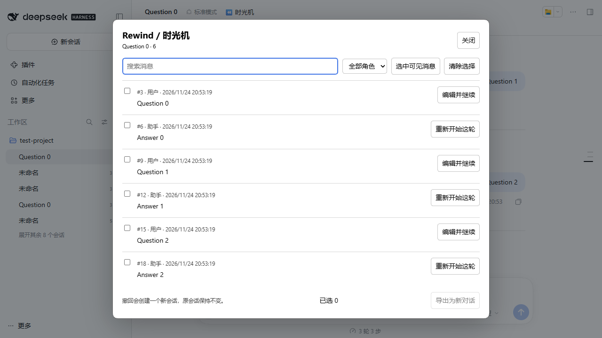
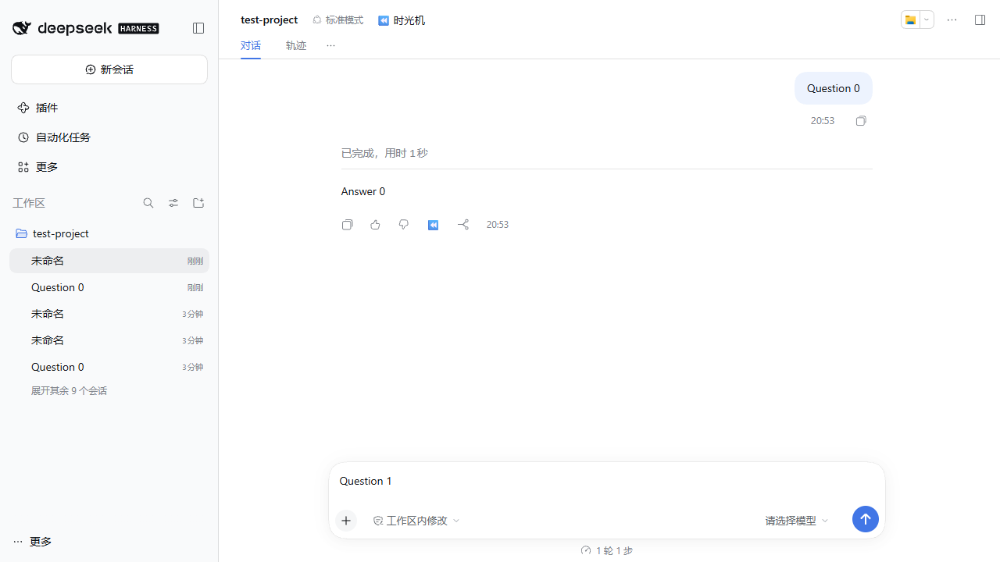
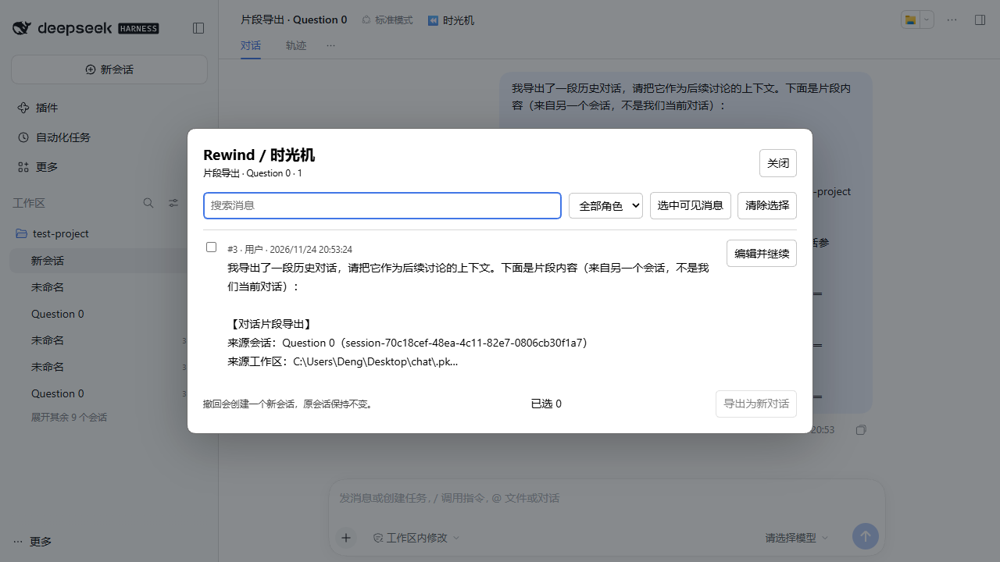

# Rewind / Time Machine
A DeepSeek Harness Web plugin for branching before a message and carrying selected conversation excerpts into a new session. Tested against 0.2.1-rc.3.

Repository: <https://github.com/saulgoodman174/dsh-conversation-branch>

## Use
Open **Time Machine** in the conversation header. Search or filter the timeline, expand a row, then choose **Edit and continue** on a user message or **Restart this turn** on an assistant response. The new session inherits the inclusive prefix ending immediately before the anchor user message. Its composer receives that user's text. The assistant action opens the timeline at the corresponding response when the host exposes that slot.

Select messages and choose **Export to new conversation**. The destination contains one append-origin user message with the excerpt, in source order. The host may append preset and policy events before it. The plugin uses the sequence returned by append and checks that flush succeeded.

## Local build and installation
Clone <https://github.com/saulgoodman174/dsh-conversation-branch.git>, then run `npm ci`, `npm run typecheck`, `npm test`, then `npm run build`. Install the checkout into a development profile with `dsh plugin --profile pkgtest add link:<absolute-checkout-path>` and restart that profile. Run `npm pack --dry-run` to inspect the distribution. Node 22.19+ (22.x) or 24+ is required. The npm package has not been published yet; install from a checkout for now.

## Transport and limitations
The plugin uses owner-authenticated same-origin POST routes under `/api/dsh-conversation-branch/`, registered through `ctx.connection.fetch.register`. Session operations first observe the requested session. Responses have an `ok` flag and failures carry a `rewind/` code. All conversation data stays on the host. No model call is needed to export or branch.

On 0.2.1-rc.3 mounting the custom Typert descriptors before reading the namespace produced `cannot get property "remote.rewind" without inject`. Declaring the namespace in client injection instead left plugin activation pending on `remote.rewind` before apply could mount it. Both traces and the authenticated route probe are under `scripts/`.

Exports default to 30,000 characters and individual messages to 8,000 before the truncation marker. Change `maxExportChars`, `maxItemChars`, `includeToolSummary`, `exportTitlePrefix` or `prefillAfterBranch` in the host entry configuration. A failed flush after creation can leave a child whose persistence is unconfirmed.

## Verification
The maintained offline baseline is `node scripts/spike-host.mjs` with `DSH_PACKAGE_ROOT` set to the extracted package directory. For the browser scenario, set `DSH_HOME` to an isolated directory named `.pkgtest-home`. Initialize it with `dsh --profile pkgtest --from-default-profile web --dump-config`, run `node scripts/pkgtest/install.mjs`, then run `node scripts/run-rpc-spike.mjs --e2e` with `DSH_APP` pointing to the desktop installation and `PLAYWRIGHT_CORE` to Playwright Core. The scenario uses a disposable local fixture and headless Edge. MIT license.

## Screenshots

## Contributing and license

See the [contribution guide](CONTRIBUTING.md), [security policy](SECURITY.md) and [MIT license](LICENSE).
