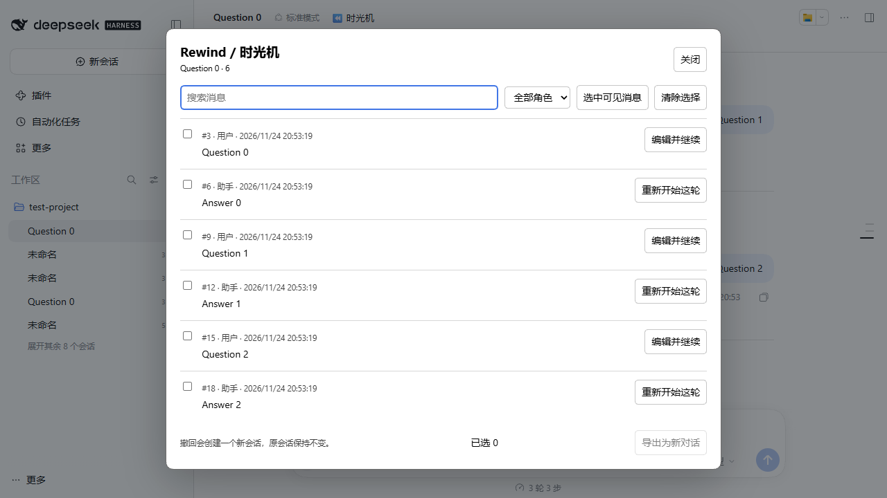
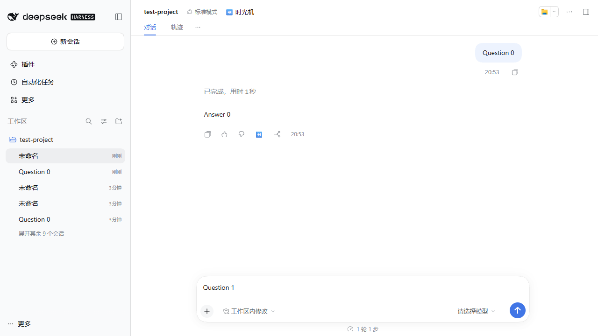
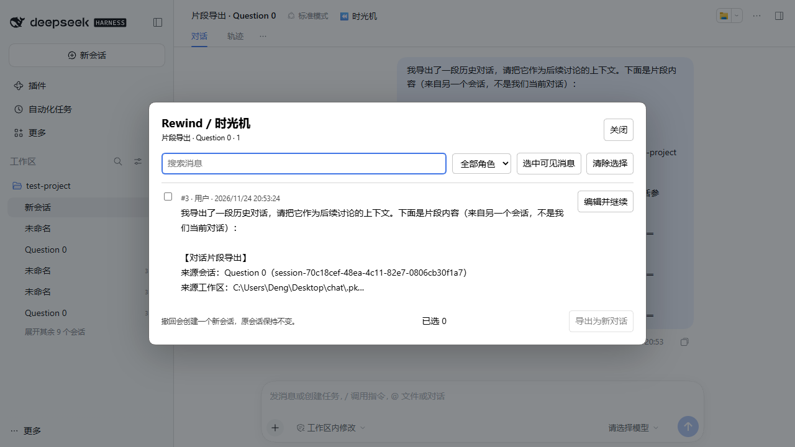

# Rewind / 时光机
仓库：<https://github.com/saulgoodman174/dsh-conversation-branch>

在 DSH Web 会话头部打开「时光机」，可以搜索、筛选消息并展开全文。用户消息上的「编辑并继续」与助手消息上的「重新开始这轮」都会创建子会话，原用户消息会预填到输入框，由用户决定何时发送。助手消息尾部的入口会定位对应消息。

勾选消息并点击「导出为新对话」后，新会话中恰好有一条包含片段的用户消息。系统初始化事件可以在它之前。分支使用包含边界的 `anchorSeq - 1`，导出记录追加返回的实际序号，并检查 flush 的布尔值。

## 构建和本地安装
从 <https://github.com/saulgoodman174/dsh-conversation-branch.git> 克隆后，依次运行 `npm ci`、`npm run typecheck`、`npm test`、`npm run build`。安装到开发 profile 可用 `dsh plugin --profile pkgtest add link:<仓库绝对路径>`，然后重启该 profile。兼容目标为 DSH 0.2.1-rc.3。包名尚未发布。

## 已知限制
0.2.1-rc.3 中，自定义 Typert 描述符挂载后访问 namespace 会报 `cannot get property "remote.rewind" without inject`。提前声明该依赖时，插件停在等待 `remote.rewind`，无法进入挂载步骤。实现采用宿主认证的同源路由 `ctx.connection.fetch.register`，每次会话操作先通过 sessionQuery 检查源会话。记录位于 scripts 目录。创建后若持久化失败，错误信息包含目标会话 ID，可能留下未确认持久化的子会话。

默认每条消息截取 8000 字符，导出上限 30000 字符。可通过 host 配置修改。插件在本机处理消息。隔离测试步骤见英文 README。MIT 许可证。

## 实测截图

## 贡献和许可证

提交改动前请阅读[贡献指引](CONTRIBUTING.md)。安全问题请参阅[安全报告说明](SECURITY.md)。项目采用 [MIT 许可证](LICENSE)。
